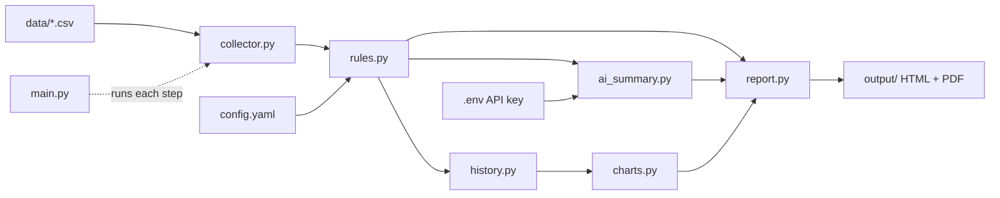

# DBA-Pulse

Automated daily database health report with an AI-written summary.

DBA-Pulse reads database health data (backup, tablespace, sessions and error log), checks it against simple rules, asks the Gemini API (free tier) to write a short plain-English summary, and builds a daily report as HTML and PDF.

Built as part of the UNAI TECH Virtual Internship 2026 (AI & Automation).

## Status

| Step | Module | Board tasks | Status |
|------|--------|-------------|--------|
| 1 | Setup, repository, sample data | T1 to T3 | Done |
| 2 | `collector.py` | T4 | Done |
| 3 | `rules.py` and tests | T5, T6 | Planned |
| 4 | `history.py` | T7 | Planned |
| 5 | `ai_summary.py` | T8, T9 | Planned |
| 6 | Report template and `charts.py` | T10, T11 | Planned |
| 7 | PDF export and `main.py` | T12 | Planned |

Phase 1, Day 3: project structure and architecture are in place. The module files are placeholders until each task is built.

## Architecture




`main.py` calls each module in order and passes the result of one step to the next as plain Python data. Only `ai_summary.py` talks to the internet, and if the AI call fails a fallback text is used so the report is still produced.


## Requirements and Planning\
Full requirements, feature and module breakdown, priorities and task list: [docs/REQUIREMENTS.md]\(docs/REQUIREMENTS.md)\
\
\| Priority | Features |\
\|----------|----------|\
\| Must Have | Collector, rules + config, AI summary (with fallback), HTML report, main.py pipeline |\
\| Should Have | History and 7-day trend, storage chart, PDF export, tests, daily scheduling |\
\| Could Have | Email or Telegram alerts, live Oracle connection, web page for past reports |


## Modules

| Module | File | Responsibility |
|--------|------|----------------|
| Orchestrator | `main.py` | Runs the pipeline in order and reports errors clearly |
| Collector | `src/collector.py` | Reads the four data tables and cleans them |
| Rules engine | `src/rules.py` | Marks each item OK, WARNING or CRITICAL using the thresholds |
| History store | `src/history.py` | Saves daily results in SQLite and returns the 7-day trend |
| AI summary | `src/ai_summary.py` | Calls the Gemini API for a short summary, with fallback text |
| Chart generator | `src/charts.py` | Draws the storage chart with matplotlib |
| Report builder | `src/report.py` | Fills the Jinja2 template and exports HTML and PDF |

## Folder structure

```
dba-pulse/
├── config/
│   └── config.yaml          thresholds for the rules
├── data/                    sample CSV files and sample.db
├── docs/
│   └── architecture.png     architecture diagram
├── output/                  generated reports (not in Git)
├── scripts/
│   └── make_sample_data.py  creates the sample data
├── src/
│   ├── __init__.py
│   ├── collector.py
│   ├── rules.py
│   ├── history.py
│   ├── ai_summary.py
│   ├── charts.py
│   └── report.py
├── templates/
│   └── report.html.j2       Jinja2 report template
├── tests/
│   └── test_rules.py
├── .env.example
├── .gitignore
├── main.py
├── README.md
└── requirements.txt
```

## Setup

```powershell
git clone https://github.com/Rafiullah-Niazi/dba-pulse.git
cd dba-pulse
python -m venv venv
venv\Scripts\Activate.ps1
pip install -r requirements.txt
python scripts/make_sample_data.py
```

Run the commands from the project root. To use the AI summary later, copy `.env.example` to `.env` and add your own Gemini API key. The `.env` file is ignored by Git and must never be uploaded.


## How to run
python main.py                              # run the full pipeline
python src/collector.py                     # collector only
python src/analyzer.py                      # analyzer only
python -m unittest discover -s tests -p "test_*.py" -v   # run tests


## Status
- Data Collector: Done (Day 5)
- Analyzer: Next (Day 6)


## Tools

Python, SQLite, Gemini API (free tier), Jinja2, matplotlib, ReportLab. Everything used in this project is free.

## Author

Rafiullah Niazi, Kabul, Afghanistan
