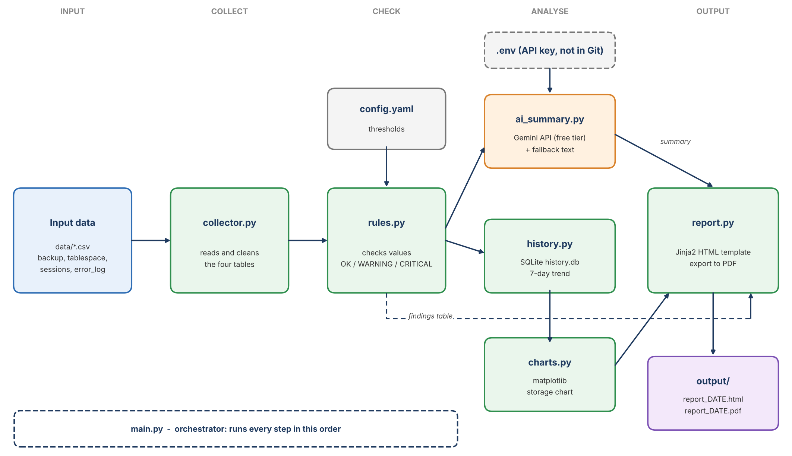

# DBA-Pulse

Automated daily database health report with an AI-written summary.

DBA-Pulse reads database health data (backup, tablespace, sessions and error log), checks it against simple rules, asks the Gemini API (free tier) to write a short plain-English summary, and builds a daily report as HTML and PDF.

Built as part of the UNAI TECH Virtual Internship 2026 (AI & Automation).

## Current Status (Phase 1, Day 10)

| Step | Module | Board tasks | Status |
|------|--------|-------------|--------|
| 1 | Setup, repository, sample data | T1 to T3 | Done |
| 2 | `collector.py` | T4 | Done (Day 5) |
| 3 | `analyzer.py` (risk rules) and tests | T5, T6 | Done (Day 6) |
| 4 | `report_generator.py` (HTML report) and tests | T10 (first version) | Done (Day 8) |
| 5 | `database.py` (SQLite, CRUD) and tests | T7 (storage) | Done (Day 9) |
| 6 | `api.py` (FastAPI backend) and tests | n/a | Done (Day 10) |
| 7 | `ai_summary.py` | T8, T9 | Planned |
| 8 | `charts.py`, 7-day trend and final report template | T11 | Planned |
| 9 | PDF export | T12 | Planned |

**What works today:** the collector, analyzer and report generator are connected by `main.py`. Each run is also saved in SQLite (`data/dba_pulse.db`), and a FastAPI backend lets you list, create, update and delete runs. All 37 automated tests pass.

**Not built yet:** AI summary, charts and 7-day trend, PDF export.

## Architecture



```mermaid
flowchart LR
&#x20;   A["data/*.csv"] --> B[collector.py]
&#x20;   B --> C[analyzer.py]
&#x20;   CFG[config.yaml] --> C
&#x20;   C --> DB[(database.py - SQLite)]
&#x20;   C --> E[ai_summary.py]
&#x20;   KEY[".env API key"] --> E
&#x20;   DB --> F[charts.py]
&#x20;   C --> G[report_generator.py]
&#x20;   E --> G
&#x20;   F --> G
&#x20;   G --> H["HTML + PDF report"]
&#x20;   API[api.py - FastAPI] <--> DB
&#x20;   M[main.py] -.runs each step.-> B
```

`main.py` calls each module in order. Each step saves its result as a JSON file that the next step reads, and the analysis is also stored in SQLite. The FastAPI backend reads and writes the same database through `database.py`. Only `ai_summary.py` will talk to the internet, and if the AI call fails a fallback text will be used so the report is still produced.

## Requirements and Planning

Full requirements, feature and module breakdown, priorities and task list: [docs/REQUIREMENTS.md](docs/REQUIREMENTS.md)

| Priority | Features |
|----------|----------|
| Must Have | Collector, rules + config, AI summary (with fallback), HTML report, main.py pipeline |
| Should Have | History and 7-day trend, storage chart, PDF export, tests, daily scheduling |
| Could Have | Email or Telegram alerts, live Oracle connection, web page for past reports |

## Modules

| Module | File | Responsibility |
|--------|------|----------------|
| Orchestrator | `main.py` | Runs the pipeline in order and reports errors clearly |
| Collector | `src/collector.py` | Reads the four data tables and cleans them |
| Analyzer (risk rules) | `src/analyzer.py` | Finds the risks in the collected data, gives each a severity, saves `data/analysis.json` |
| Report generator | `src/report_generator.py` | Reads `data/analysis.json`, validates it and builds `data/report.html` with a status, severity cards and a sorted findings table |
| Database | `src/database.py` | Stores each analysis run and its findings in SQLite (create, read, update, delete) |
| API | `src/api.py` | FastAPI backend: REST endpoints for runs and findings, input validation and error codes |
| AI summary | `src/ai_summary.py` | Calls the Gemini API for a short summary, with fallback text (planned) |
| Chart generator | `src/charts.py` | Draws the storage chart with matplotlib (planned) |

## Folder structure

```
dba-pulse/
├── config/
│   └── config.yaml          thresholds for the rules
├── data/                    sample data and generated files
├── docs/
│   ├── architecture.png     architecture diagram
│   ├── database.md          database schema and operations
│   └── api.md               API endpoints
├── scripts/
│   ├── make_sample_data.py  creates the sample data
│   └── db_demo.py           CRUD demonstration
├── src/
│   ├── collector.py
│   ├── analyzer.py
│   ├── report_generator.py
│   ├── database.py
│   └── api.py
├── templates/
├── tests/
│   ├── test_collector.py
│   ├── test_analyzer.py
│   ├── test_pipeline.py
│   ├── test_report_generator.py
│   ├── test_database.py
│   └── test_api.py
├── .env.example
├── .gitignore
├── main.py
├── README.md
└── requirements.txt
```

## Setup

```powershell
git clone https://github.com/Rafiullah-Niazi/dba-pulse.git
cd dba-pulse
python -m venv venv
venvScriptsActivate.ps1
pip install -r requirements.txt
python scripts/make_sample_data.py
```

Run the commands from the project root. To use the AI summary later, copy `.env.example` to `.env` and add your own Gemini API key. The `.env` file is ignored by Git and must never be uploaded.

## How to run

1. Activate the virtual environment:
&#x20;  ```
&#x20;  venvScriptsactivate
&#x20;  ```
2. Run the full pipeline (collector, analyzer, database, report):
&#x20;  ```
&#x20;  python main.py
&#x20;  ```
3. Open `data/report.html` in your browser to see the report.
4. Run only the report generator (after the analyzer has run):
&#x20;  ```
&#x20;  python src/report_generator.py
&#x20;  ```
5. Run the tests:
&#x20;  ```
&#x20;  python -m unittest discover -s tests -p "test_*.py" -v
&#x20;  ```

## Database

DBA-Pulse stores each analysis run in SQLite (`data/dba_pulse.db`) using
`src/database.py` (tables: `runs`, `findings`; full CRUD). The database is
filled automatically by `python main.py`.

- Schema and operations: [docs/database.md](docs/database.md)
- Demo of Create/Read/Update/Delete: `python scripts/db_demo.py`
- Tests: `python -m unittest discover -s tests -p "test_*.py" -v`

## API

The backend is built with FastAPI and uses `database.py` for all data access.

Start the backend:

```
python -m uvicorn src.api:app --reload
```

Open `http://127.0.0.1:8000/docs` for the interactive Swagger page.

| Method | Endpoint | Purpose |
|--------|----------|---------|
| GET | `/` | Health check |
| GET | `/runs` | List latest runs |
| GET | `/runs/{id}` | Get one run |
| GET | `/runs/{id}/findings` | Findings of one run |
| POST | `/runs` | Create a run with findings |
| PUT | `/runs/{id}/status` | Update overall status |
| DELETE | `/runs/{id}` | Delete a run and its findings |
| GET | `/report` | Latest HTML report |

Full details, examples and error codes: [docs/api.md](docs/api.md)

## Progress log

- Day 5: Data Collector done
- Day 6: Analyzer done and connected to the collector through `main.py`
- Day 8: Report Generator done (HTML report) and connected to the pipeline
- Day 9: SQLite database layer added (`database.py`, CRUD, tests)
- Day 10: FastAPI backend added (`api.py`, 8 endpoints, 7 API tests)
- Next: AI summary with the Gemini API

## Tools

Python, SQLite, FastAPI, Gemini API (free tier), Jinja2, matplotlib, ReportLab. Everything used in this project is free.

## Author

Rafiullah Niazi, Kabul  Afghanistan                                                                                                                                                                                          