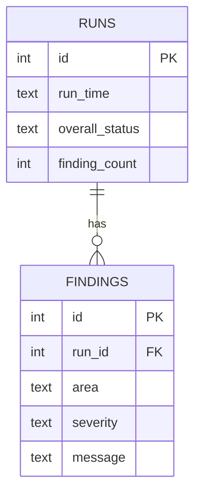

# Database Documentation

DBA-Pulse stores every analysis run in a local **SQLite** database
(`data/dba_pulse.db`). SQLite needs no server, user or password, so there
are no secrets to protect or upload.

## Schema

| Table | Purpose |
|-------|---------|
| `runs` | One row per pipeline execution (time, overall status, number of findings) |
| `findings` | One row per finding, linked to its run by `run_id` (area, severity, message) |

Relationship: one run has many findings. Deleting a run also deletes its
findings (`ON DELETE CASCADE`).

## Operations (`src/database.py`)

| Operation | Function | Description |
|-----------|----------|-------------|
| Create | `save_run()` | Inserts a run and all its findings from `analysis.json` |
| Read | `list_runs()`, `get_findings()` | Lists recent runs; returns the findings of a run |
| Update | `update_run_status()` | Changes the overall status of a run |
| Delete | `delete_run()` | Removes a run and its findings |

## Integration

`main.py` runs: Collector -> Analyzer -> **save to database** -> Report.
Run `python scripts/db_demo.py` to see all four operations demonstrated.

## Security

The database file is generated at runtime and is excluded from Git
(`.gitignore`). No passwords, connection strings or API keys are used or stored.
